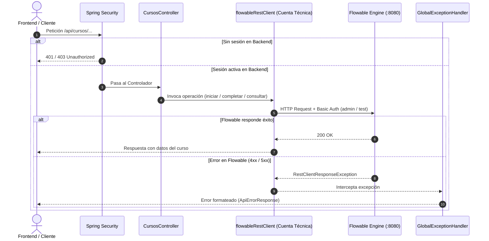

# Arquitectura del Backend Proxy: Cuenta Técnica, Seguridad y Manejo de Errores

El módulo `backend` actúa como Backend-for-Frontend (BFF) e intermediario de integración entre los clientes (frontend institucional y empresas) y el motor Flowable (puerto 8080). Centraliza la autenticación mediante sesiones estándar de Spring Security y canaliza todas las consultas y cambios de estado en los procesos a través de una **cuenta técnica única** (*Service Account*) vía HTTP Basic Auth, simplificando la infraestructura y garantizando una separación clara de responsabilidades.

---

## Flujo Rápido (Quick Path)

El ciclo de interacción consta de tres etapas directas sin manipulación de cookies externas:

1. **Autenticación Institucional (`FlowableAuthService`):**
   El usuario envía su usuario y contraseña a `/api/auth/login`. El backend valida las credenciales contra Flowable (`/me`) y, de ser válidas, establece de forma nativa la sesión de Spring Security en el `HttpSession` bajo `SPRING_SECURITY_CONTEXT`.

2. **Seguridad y Control de Acceso (`SecurityConfig`):**
   Las rutas de negocio (`/api/cursos/**`) requieren autenticación activa (`.anyRequest().authenticated()`). Spring Security frena en la puerta a cualquier petición anónima sin sobrecargar llamadas hacia Flowable.

3. **Operaciones con Cuenta Técnica (`RestClientConfig`):**
   Los controladores consumen el bean inyectado `flowableRestClient`. Este cliente incorpora automáticamente las credenciales técnicas configuradas (`flowable.username` y `flowable.password`) en cada petición al motor.

4. **Tratamiento Centralizado de Excepciones (`GlobalExceptionHandler`):**
   Cualquier error de respuesta devuelto por Flowable (HTTP 4xx / 5xx) es capturado como `RestClientResponseException` y transformado al contrato estándar `ApiErrorResponse`.



---

## Componentes Técnicos y Decisiones

| Componente | Paquete | Responsabilidad Técnica |
|---|---|---|
| `RestClientConfig` | `com.backend.proxy.config` | Configura el bean `flowableRestClient` inyectando la URL base (`${flowable.base-url}`) y las credenciales técnicas fijas con HTTP Basic Auth. |
| `FlowableAuthService` | `com.backend.proxy.auth` | Verifica credenciales institucionales contra Flowable `/me` y registra el `UsernamePasswordAuthenticationToken` en el `SecurityContext` de Spring. |
| `SecurityConfig` | `com.backend.proxy.security` | Define las reglas de acceso con `SessionCreationPolicy.IF_REQUIRED`, CORS para entornos de desarrollo y exclusión pública de `/api/auth/login` y `/health`. |
| `CompanyAccessService` | `com.backend.proxy.service` | Habilita el acceso de la empresa (§4.1.2) desde la actividad automática del proceso: crea la cuenta (usuario derivado de la razón social + contraseña BCrypt en `companies.access_username` / `access_password_hash`) o reutiliza la de una contratación anterior. Se expone en `POST /api/flowable/courses/{processId}/company-access`, protegido por `X-API-KEY`. |
| `GlobalExceptionHandler` | `com.backend.proxy.exception` | `@RestControllerAdvice` que captura `RestClientResponseException` y retorna el payload estándar `ApiErrorResponse`. |
| `ApiErrorResponse` | `com.backend.proxy.exception` | Registro inmutable (`record`) para respuestas uniformes de error (timestamp, status, error, message, path). |

---

## Configuración del Servicio

Las credenciales técnicas de Flowable se administran centralizadamente en `src/main/resources/application.properties`:

```properties
server.port=8081

flowable.base-url=http://localhost:8080
flowable.username=admin
flowable.password=test
```

---

## Manejo de Excepciones y Formato de Respuesta

Cuando ocurre una falla de integración o el motor de procesos rechaza una operación, el manejador global devuelve una respuesta con formato unificado:

```json
{
  "timestamp": "2026-11-05T16:00:00.123456Z",
  "status": 500,
  "error": "FLOWABLE_INTEGRATION_ERROR",
  "message": "Error en la comunicación con Flowable: Internal Server Error",
  "path": "/api/cursos/iniciar"
}
```

---

## Ventajas Arquitectónicas del Modelo

> [!NOTE]
> **Simplicidad y Robustez:**
> Se prescinde de filtros personalizados, variables `ThreadLocal` y captura manual de cookies `JSESSIONID`. Spring Security gestiona las sesiones de los usuarios finales de manera estándar y aislada.

> [!IMPORTANT]
> **Seguridad y Visibilidad de Tareas:**
> Cada controlador inyecta al usuario autenticado mediante `@AuthenticationPrincipal String username` y lo pasa a las consultas de Flowable (ej: `GET /runtime/tasks?candidateOrAssigned={username}`), asegurando que cada rol solo acceda a sus tareas permitidas.

---

## Lista de Verificación (Checklist)

- [ ] Todas las llamadas hacia Flowable se realizan exclusivamente a través del bean inyectado `flowableRestClient`.
- [ ] La identidad del usuario autenticado se obtiene de Spring Security (`@AuthenticationPrincipal`) y se pasa en los parámetros o payloads de Flowable según corresponda.
- [ ] Las credenciales del usuario técnico (`flowable.username` y `flowable.password`) se mantienen seguras y parametrizadas por entorno.

---

## Siguientes Pasos

1. **Controlador de Autenticación (`AuthController`):** Exponer `POST /api/auth/login` (consumiendo `FlowableAuthService.login`) y `POST /api/auth/logout`.
2. **Controladores de Cursos (`CursosController`):** Implementar endpoints de negocio bajo `/api/cursos` que utilicen `flowableRestClient` para iniciar instancias, consultar tareas asignadas y completar formularios.
