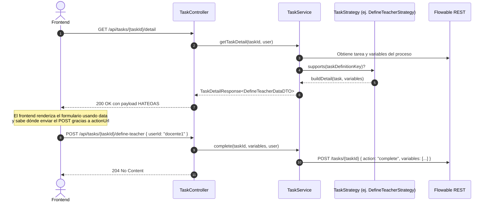

# Patrón Strategy para Tareas (HATEOAS)

Para desacoplar el frontend de los esquemas internos de variables de Flowable y soportar formularios ricos sin lógica condicional dispersa, el backend implementa el patrón **Strategy + HATEOAS + Endpoints Tipados de Acción** (definido formalmente en el ADR `adr/strategy-detalle-tareas.md`).

---

## El Problema Resuelto

Las tareas de usuario de Flowable (`UserTask`) tienen naturalezas distintas:
1. Algunas requieren únicamente confirmación (ej. *Preparar materiales*, *Desarrollar curso*).
2. Otras requieren formularios complejos y variables de contexto previas (ej. *Definir docente*, *Elaborar informe de resultados*, *Registrar y elaborar propuesta*).

Exponer variables crudas de Flowable al frontend obliga al cliente a conocer nombres de variables del BPMN y dificulta la validación estricta de datos.

> [!NOTE]
> **Fundamentos de HATEOAS:**
> Para comprender qué es el nivel 3 del modelo de madurez de Richardson (HATEOAS), sus principios rectores y en qué escenarios arquitectónicos conviene aplicarlo, consultá la guía en [Mentores Tech: ¿Qué es HATEOAS y cuándo aplicarlo?](https://www.mentorestech.com/resource-blog-content/que-es-hateoas-y-cuando-aplicarlo).

---

## La Solución Arquitectónica



---

## Contrato HATEOAS: `TaskDetailResponse<T>`

Cada estrategia construye una respuesta inmutable tipada:

```json
{
  "taskId": "7501",
  "taskName": "Definir docente que desarrolla el curso",
  "actionUrl": "/api/tasks/7501/define-teacher",
  "data": {
    "courseName": "Kubernetes para Empresas",
    "companyName": "Tech Corp SA",
    "availableTeachers": [
      { "id": "prof_gonzalez", "fullName": "Carlos González", "email": "carlos@instituto.edu" },
      { "id": "prof_martinez", "fullName": "Laura Martínez", "email": "laura@instituto.edu" }
    ]
  }
}
```

### Ventajas Clave
- **Un solo viaje de red (Single Roundtrip):** El cliente recibe tanto el contexto de negocio necesario para mostrar la pantalla como la lista de opciones válidas (ej. docentes disponibles).
- **Desacoplamiento HATEOAS:** El frontend no codifica rutas fijas: lee `actionUrl` y envía la respuesta directamente a ese endpoint.
- **Validación Fuerte (`@Valid`):** La acción no recibe un mapa genérico, sino un DTO fuertemente tipado (`DefineTeacherRequestDTO`) con validaciones de Bean Validation (`@NotNull`, `@NotBlank`).

---

## Catálogo de Estrategias Implementadas

| Estrategia | `taskDefinitionKey` | Endpoint de Acción | DTO de Contexto |
|---|---|---|---|
| `DefineTeacherStrategy` | `definirdocentequedesarrollaelcurso` | `POST .../define-teacher` | `DefineTeacherDataDTO` (incluye lista de docentes consultados de Flowable IDM) |
| `DeliverCourseStrategy` | `desarrollarcurso` | `POST .../deliver-course` | `DeliverCourseDataDTO` |
| `PrepareReportStrategy` | `elaborarinformederesultados` | `POST .../prepare-report` | `PrepareReportDataDTO` |
| `SendReportStrategy` | `enviarinformeaempresayarchivarexpediente` | `POST .../send-report` | `SendReportDataDTO` |

---

## Tareas Directas vs. Tareas con Formulario

La clase [`TaskCatalog`](file:///home/francisco/GTPN-GestionCursos-Flowable/backend/src/main/java/com/backend/proxy/types/TaskCatalog.java) clasifica centralizadamente las tareas:
- **Tareas Directas (`DIRECTAS`):** No requieren datos adicionales; se completan con un clic enviando las variables por defecto registradas en el catálogo.
- **Tareas con Formulario (`CON_FORMULARIO`):** Requieren pantalla dedicada y estrategia de agregación de contexto.

---

## Referencias

- [Mentores Tech: ¿Qué es HATEOAS y cuándo aplicarlo?](https://www.mentorestech.com/resource-blog-content/que-es-hateoas-y-cuando-aplicarlo)
- [Microsoft Learn: Patrón Backends for Frontends (BFF)](https://learn.microsoft.com/es-es/azure/architecture/patterns/backends-for-frontends)
- [ADR Local: Estrategia de Detalle de Tareas](file:///home/francisco/GTPN-GestionCursos-Flowable/adr/strategy-detalle-tareas.md)

---

## Próximo Paso

- Revisa los endpoints disponibles en [Controladores REST](../api/controladores.md).
