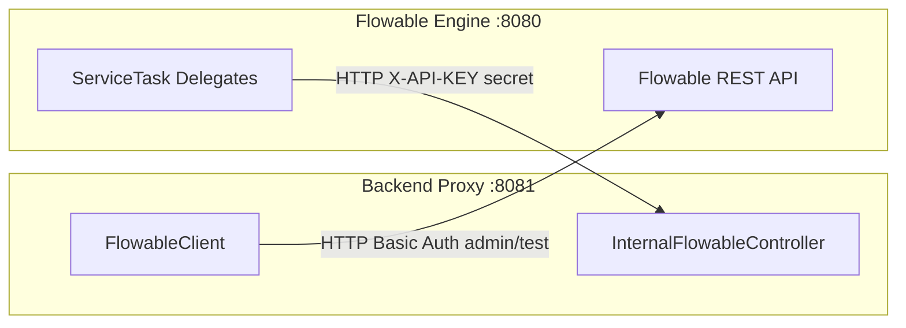

# Integración con Flowable Engine

La interacción entre el backend y el motor Flowable es bidireccional y se encuentra desacoplada: el backend orquesta y consulta tareas utilizando una cuenta técnica unificada, mientras que Flowable invoca al backend mediante callbacks protegidos para actualizar estados y generar accesos.

---

## Comunicación Bidireccional



---

## 1. Llamadas Salientes: Cuenta Técnica Unificada

En lugar de propagar credenciales individuales de los usuarios a Flowable, el backend utiliza un cliente HTTP centralizado ([`RestClientConfig`](file:///home/francisco/GTPN-GestionCursos-Flowable/backend/src/main/java/com/backend/proxy/config/RestClientConfig.java)):

```java
@Bean
public RestClient flowableRestClient(
        @Value("${flowable.base-url:http://localhost:8080}") String flowableBaseUrl,
        @Value("${flowable.username:admin}") String flowableUsername,
        @Value("${flowable.password:test}") String flowablePassword,
        FlowableClientLoggingInterceptor loggingInterceptor
) {
    return RestClient.builder()
            .baseUrl(flowableBaseUrl)
            .defaultHeaders(headers -> {
                headers.setBasicAuth(flowableUsername, flowablePassword);
                headers.set(HttpHeaders.CONTENT_TYPE, MediaType.APPLICATION_JSON_VALUE);
                headers.set(HttpHeaders.ACCEPT, MediaType.APPLICATION_JSON_VALUE);
            })
            .requestInterceptor(loggingInterceptor)
            .build();
}
```

### Componente `FlowableClient`
Encapsula las llamadas REST salientes:
- **`startCourseProcess`**: Inicia la instancia del proceso enviando el payload inicial. Cuenta con reintentos automáticos mediante `@Retryable` (3 intentos con backoff exponencial).
- **Consultas de tareas**: Consulta la bandeja de tareas activas (`/process-api/runtime/tasks`) filtrando por usuario asignado o candidato.
- **Completitud de tareas**: Envía variables del formulario de resolución al motor (`/process-api/runtime/tasks/{taskId}`).
- **Consulta de usuarios**: Recupera la lista de usuarios y grupos del IDM de Flowable para poblar combos y selectores (ej. lista de docentes).

---

## 2. Llamadas Entrantes: Callbacks Internos de Flowable

Las tareas de servicio de Flowable (Java Delegates) notifican al backend eventos clave del ciclo de vida del proceso mediante [`InternalFlowableController`](file:///home/francisco/GTPN-GestionCursos-Flowable/backend/src/main/java/com/backend/proxy/controller/InternalFlowableController.java):

| Método HTTP | Ruta | Seguridad | Descripción |
|---|---|---|---|
| `PUT` | `/api/flowable/courses/{processId}` | `X-API-KEY` | Sincroniza el estado del curso (`CourseStatus`) cuando el proceso transiciona entre hitos BPMN. |
| `PUT` | `/api/flowable/courses/{processId}/details` | `X-API-KEY` | Actualiza fechas confirmadas o datos consolidados de la propuesta. |
| `POST` | `/api/flowable/courses/{processId}/company-access` | `X-API-KEY` | Invocado por la actividad automática *Habilitar acceso de la empresa* (§4.1.2) para generar o reutilizar credenciales. |

> [!IMPORTANT]
> **Seguridad de Callbacks:**
> Todas las rutas `/api/flowable/**` son filtradas por [`ApiKeyFilter`](file:///home/francisco/GTPN-GestionCursos-Flowable/backend/src/main/java/com/backend/proxy/security/ApiKeyFilter.java). Las peticiones sin el header `X-API-KEY` coincidente con `flowable.api-key` son rechazadas inmediatamente.

---

## Trazabilidad y Logging

Todas las solicitudes que atraviesan `flowableRestClient` pasan por `FlowableClientLoggingInterceptor`, registrando en consola el método HTTP, la URL y el tiempo de respuesta, facilitando la depuración del flujo BPMN en desarrollo y auditoría.

---

## Próximo Paso

- Descubre cómo se resuelven dinámicamente las tareas de usuario en [Patrón Strategy para Tareas](estrategia-tareas.md).
