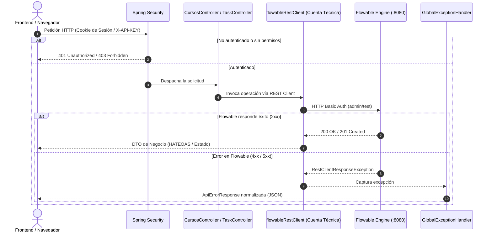

# Visión General de Arquitectura

El módulo `backend` actúa como **Backend-for-Frontend (BFF)** y mediador de integración entre los clientes (interfaz web institucional, portal de empresas y servicios externos) y el motor Flowable (puerto 8080). Centraliza la autenticación, la persistencia de entidades de negocio y canaliza todas las operaciones del proceso a través de una **cuenta técnica única** (*Service Account*) vía HTTP Basic Auth.

---

## Flujo de Integración

El ciclo de vida de una petición típica se describe en el siguiente diagrama de secuencia:

---

## Pilares Arquitectónicos

### 1. Modelo Backend-for-Frontend (BFF)
El frontend y los usuarios finales **nunca interactúan directamente con el motor Flowable**:
- Se oculta la complejidad del modelo interno de BPMN (IDs de ejecución, variables internas, definiciones de proceso).
- Se exponen contratos DTO semánticos y orientados a la vista (`CourseResponseDTO`, `TaskDetailResponse`, etc.).

> [!NOTE]
> **Patrón Arquitectónico de Referencia:**
> Para comprender en profundidad los fundamentos y ventajas de crear servicios backend especializados para interfaces cliente, consultá la guía oficial en [Microsoft Learn: Patrón Backends for Frontends (BFF)](https://learn.microsoft.com/es-es/azure/architecture/patterns/backends-for-frontends).

### 2. Cuenta Técnica Unificada (*Service Account*)
Todas las llamadas del backend hacia Flowable se realizan con un usuario de servicio administrativo configurado en `application.properties`:
- **Ventaja:** Elimina la necesidad de sincronizar tokens o cookies `JSESSIONID` ajenas entre múltiples servicios.
- **Auditoría:** La identidad real del operador se envía en variables del proceso (ej. `docenteSeleccionado`, `evaluador`, `claimant`) para trazabilidad BPMN.

### 3. Delimitación de Persistencia: Proceso vs. Base de Datos
Siguiendo la decisión de diseño de persistencia:
- **Flowable:** Almacena variables de estado de flujo, control de rutas BPMN, asignaciones de tareas y temporizadores.
- **Base de Datos PostgreSQL (Backend):** Almacena registros permanentes, histórico de propuestas, documentos PDF generados, información tributaria/contacto de empresas y credenciales de acceso.

---

## Componentes Principales

| Componente | Paquete | Responsabilidad |
|---|---|---|
| `BackendApp` | `com.backend.proxy` | Clase principal de inicio Spring Boot 3. |
| `RestClientConfig` | `com.backend.proxy.config` | Configura el bean `flowableRestClient` con HTTP Basic Auth y timeouts. |
| `FlowableClient` | `com.backend.proxy.client` | Abstracción de llamadas HTTP hacia la API REST de Flowable. |
| `SecurityConfig` | `com.backend.proxy.security` | Reglas de autorización para API REST y páginas web. |
| `GlobalExceptionHandler` | `com.backend.proxy.exception` | Interceptor global que transforma fallos en `ApiErrorResponse`. |

---

## Referencias Externas

- [Microsoft Learn: Patrón Backends for Frontends (BFF)](https://learn.microsoft.com/es-es/azure/architecture/patterns/backends-for-frontends)
- [Mentores Tech: Qué es HATEOAS y cuándo aplicarlo](https://www.mentorestech.com/resource-blog-content/que-es-hateoas-y-cuando-aplicarlo)

---

## Próximo Paso

- Consulta cómo se implementa el esquema de seguridad y autenticación en [Seguridad y Autenticación](seguridad.md).
