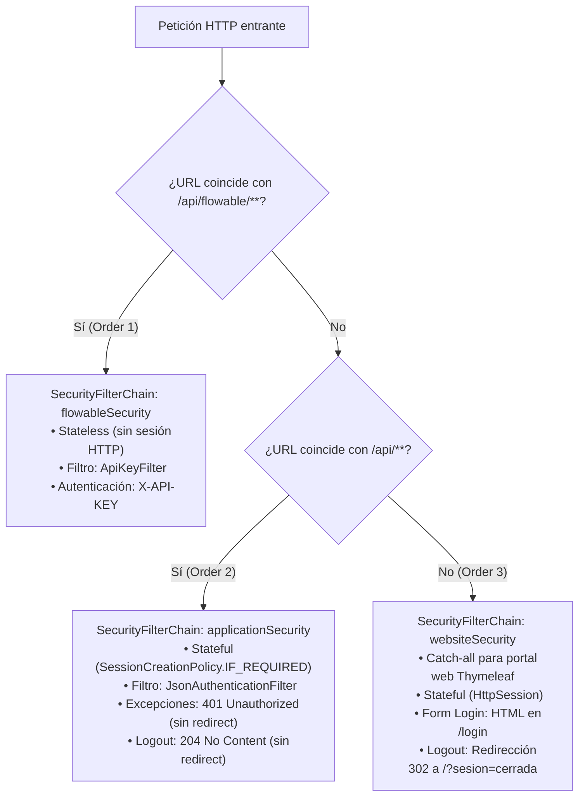
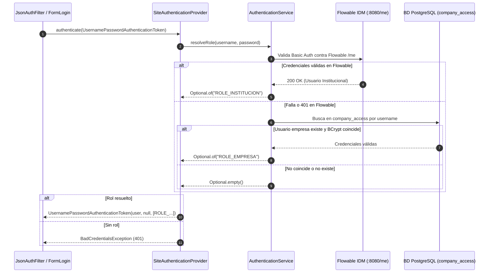

# Seguridad y Organización de Filtros

El subsistema de seguridad del backend está estructurado con **Spring Security 6 (Spring Boot 3)** utilizando múltiples cadenas de filtros ([`SecurityFilterChain`](https://docs.spring.io/spring-security/reference/servlet/architecture.html#servlet-securityfilterchain)) jerarquizadas mediante la anotación `@Order`. Esta arquitectura permite atender en una misma aplicación tres contextos con necesidades de autenticación y transporte completamente diferentes:
1. Llamadas M2M sin estado (*stateless*) desde Flowable.
2. Clientes REST / SPA con intercambio JSON y sesiones estándar.
3. Portal web interactivo con formularios HTML (Thymeleaf).

---

## Jerarquía y Despacho de Cadenas de Filtros

Spring Security evalúa las cadenas de filtros en orden secuencial según su prioridad `@Order`. La primera cadena cuyo `securityMatcher` coincida con la URL entrante toma el control exclusivo de la petición:



---

## Comparativa Detallada de las Tres Cadenas

| Aspecto | Cadena 1: `flowableSecurity` (`@Order(1)`) | Cadena 2: `applicationSecurity` (`@Order(2)`) | Cadena 3: `websiteSecurity` (`@Order(3)`) |
|---|---|---|---|
| **Matcher de Ruta** | `/api/flowable/**` | `/api/**` | Catch-all (rutas web restantes) |
| **Audiencia** | Motor Flowable (Machine-to-Machine) | SPA, Frontends modernos y clientes REST | Usuarios navegando en portal Thymeleaf |
| **Gestión de Sesión** | `SessionCreationPolicy.STATELESS` | `SessionCreationPolicy.IF_REQUIRED` | `SessionCreationPolicy.IF_REQUIRED` |
| **Mecanismo Auth** | Header `X-API-KEY` | JSON `POST /api/auth/login` | Formulario HTML `POST /login` |
| **Filtro Personalizado** | `ApiKeyFilter` | `JsonAuthenticationFilter` | `UsernamePasswordAuthenticationFilter` nativo |
| **Respuesta No Auth** | HTTP 403 / 401 | HTTP 401 (`HttpStatusEntryPoint`) | HTTP 302 Redirect a `/login` |
| **Comportamiento Logout**| N/A (Stateless) | HTTP 204 `NO_CONTENT` en `/api/auth/logout` | HTTP 302 Redirect a `/?sesion=cerrada` |
| **CSRF** | Deshabilitado | Deshabilitado | Deshabilitado |

---

## Organización y Posicionamiento de Filtros

### 1. `ApiKeyFilter` y el Patrón de Deshabilitación de Registro Global

Uno de los desafíos comunes en Spring Boot es que cualquier filtro anotado con `@Component` es detectado automáticamente por el contenedor de Servlets y registrado en la cadena raíz de filtros global (ejecutándose para **todas** las URLs del sistema).

Para evitar que `ApiKeyFilter` se ejecute innecesariamente en rutas web o en el login de usuarios, se utiliza un `FilterRegistrationBean` explícito con `setEnabled(false)`:

```java
@Bean
public FilterRegistrationBean<ApiKeyFilter> apiKeyFilterRegistration(ApiKeyFilter filter) {
    FilterRegistrationBean<ApiKeyFilter> registration = new FilterRegistrationBean<>(filter);
    registration.setEnabled(false); // Evita el registro automático en el Servlet container
    return registration;
}
```

Luego, se inyecta **únicamente** en la cadena de Flowable con posicionamiento explícito:

```java
@Bean
@Order(1)
public SecurityFilterChain flowableSecurity(HttpSecurity http, ApiKeyFilter apiKeyFilter) throws Exception {
    return http
        .securityMatcher("/api/flowable/**")
        .sessionManagement(s -> s.sessionCreationPolicy(SessionCreationPolicy.STATELESS))
        .authorizeHttpRequests(auth -> auth.anyRequest().authenticated())
        .addFilterBefore(apiKeyFilter, UsernamePasswordAuthenticationFilter.class)
        .build();
}
```

#### Funcionamiento Interno de `ApiKeyFilter`:
1. Lee el encabezado HTTP `X-API-KEY`.
2. Compara el valor contra la propiedad inyectada `flowable.api-key`.
3. Si coincide, genera un `UsernamePasswordAuthenticationToken` con la autoridad `ROLE_FLOWABLE_SERVICE` y lo almacena en el `SecurityContextHolder`.

---

### 2. `JsonAuthenticationFilter` para la API REST

En la arquitectura REST, el login se envía como cuerpo JSON (`{"username": "...", "password": "..."}`) y no como `application/x-www-form-urlencoded`.

[`JsonAuthenticationFilter`](file:///home/francisco/GTPN-GestionCursos-Flowable/backend/src/main/java/com/backend/proxy/security/JsonAuthenticationFilter.java) hereda de `AbstractAuthenticationProcessingFilter` y se ubica antes de `UsernamePasswordAuthenticationFilter`:

```java
@Bean
@Order(2)
public SecurityFilterChain applicationSecurity(
        HttpSecurity http,
        SiteAuthenticationProvider siteAuthenticationProvider,
        ObjectMapper objectMapper
) throws Exception {
    AuthenticationManager authenticationManager = new ProviderManager(siteAuthenticationProvider);
    
    JsonAuthenticationFilter jsonAuthenticationFilter = new JsonAuthenticationFilter(
            "/api/auth/login",
            authenticationManager,
            objectMapper
    );

    return http
        .securityMatcher("/api/**")
        .sessionManagement(s -> s.sessionCreationPolicy(SessionCreationPolicy.IF_REQUIRED))
        .securityContext(context -> context
            .securityContextRepository(new HttpSessionSecurityContextRepository())
        )
        .authorizeHttpRequests(auth -> auth
            .requestMatchers(PUBLIC_URLS).permitAll()
            .anyRequest().authenticated()
        )
        .addFilterBefore(jsonAuthenticationFilter, UsernamePasswordAuthenticationFilter.class)
        .logout(logout -> logout
            .logoutUrl("/api/auth/logout")
            .logoutSuccessHandler((req, res, auth) -> res.setStatus(HttpStatus.NO_CONTENT.value()))
        )
        .exceptionHandling(handling -> handling
            .authenticationEntryPoint(new HttpStatusEntryPoint(HttpStatus.UNAUTHORIZED))
        )
        .build();
}
```

#### Puntos Clave de Diseño en `JsonAuthenticationFilter`:
- **Deserialización con `ObjectMapper`:** Parsea el cuerpo de la petición a `LoginRequestDTO`.
- **Persistencia en Sesión:** Invoca `setSecurityContextRepository(new HttpSessionSecurityContextRepository())`, asegurando que al autenticar exitosamente, el `SecurityContext` se escriba en el `HttpSession` estándar.
- **`AuthenticationSuccessHandler` JSON:** En vez de hacer un redirect HTTP 302, escribe un `LoginResponseDTO` con HTTP 200 OK:
  ```json
  {
    "username": "jefedocente",
    "role": "INSTITUCION",
    "authenticated": true
  }
  ```
- **`AuthenticationFailureHandler` JSON:** En caso de credenciales inválidas, devuelve un error JSON con código HTTP 401 Unauthorized sin redirección HTML.
- **Tratamiento de Excepciones No Autenticadas (`HttpStatusEntryPoint`):** Si un cliente consume `/api/courses` sin sesión, Spring Security devuelve `401 Unauthorized` directo, evitando que un cliente REST reciba por error el HTML de la página de login.

---

### 3. `websiteSecurity` para el Portal Web

La tercera cadena cubre las solicitudes que no coinciden con `/api/**`:
- Activa `formLogin` estándar escuchando en `/login`.
- Si las credenciales son válidas, redirige al usuario a `/panel` o a la bandeja de tareas `/tareas`.
- En caso de error, redirige a `/login?error`.
- El logout redirige a `/?sesion=cerrada`.

---

## Proveedor de Autenticación Unificado: `SiteAuthenticationProvider`

Tanto `applicationSecurity` (mediante `ProviderManager`) como `websiteSecurity` (como provider de la cadena) delegan la verificación en [`SiteAuthenticationProvider`](file:///home/francisco/GTPN-GestionCursos-Flowable/backend/src/main/java/com/backend/proxy/security/SiteAuthenticationProvider.java).

Este componente utiliza `AuthenticationService.resolveRole(username, password)` para resolver la identidad de forma polimórfica:



---

## Configuración de CORS

Para habilitar el desarrollo local desacoplado (por ejemplo, con frontends en Vite `localhost:5173` o Next.js/React `localhost:3000`), el bean `CorsConfigurationSource` permite el intercambio seguro de cookies de sesión:

```java
@Bean
public CorsConfigurationSource corsConfigurationSource() {
    CorsConfiguration configuration = new CorsConfiguration();
    configuration.setAllowedOriginPatterns(List.of("http://localhost:3000", "http://localhost:5173", "*"));
    configuration.setAllowedMethods(List.of("GET", "POST", "PUT", "DELETE", "PATCH", "OPTIONS"));
    configuration.setAllowedHeaders(List.of("*"));
    configuration.setAllowCredentials(true); // Crucial para permitir cookies JSESSIONID entre orígenes

    UrlBasedCorsConfigurationSource source = new UrlBasedCorsConfigurationSource();
    source.registerCorsConfiguration("/**", configuration);
    return source;
}
```

---

## Resumen de Mejores Prácticas Aplicadas

1. **Separación estricta por `@Order`:** Las llamadas de máquina a máquina no contaminan la sesión de los usuarios finales ni sufren penalizaciones por filtros web.
2. **Stateless donde corresponde:** `/api/flowable/**` no almacena nada en sesión, minimizando el consumo de memoria en ráfagas de callbacks BPMN.
3. **No filtración de HTML en clientes REST:** Uso de `HttpStatusEntryPoint(HttpStatus.UNAUTHORIZED)` y `JsonAuthenticationFilter` para garantizar que un cliente SPA reciba siempre JSON y códigos HTTP canónicos.
4. **Desactivación de escaneo para filtros especializados:** El `FilterRegistrationBean` previene efectos colaterales de ejecución global en Servlets.

---

## Próximo Paso

- Revisa la integración técnica con el motor BPMN en [Integración con Flowable](integracion-flowable.md).
