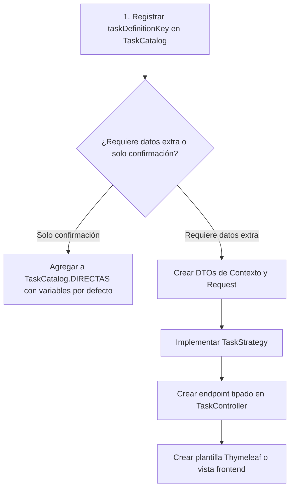

# Convenciones y Extensión del Sistema

Esta guía resume las convenciones arquitectónicas del código fuente del backend y describe el procedimiento paso a paso para añadir nuevas tareas de usuario de Flowable BPM al sistema.

---

## Convenciones de Código y Nomenclatura

1. **Inglés para código e identificadores:**
   - Todos los identificadores, nombres de clases, métodos, variables, DTOs y comentarios técnicos deben escribirse en **inglés** (ej. `TaskDetailResponse`, `FlowableClient`, `DefineTeacherStrategy`).
   - Los textos de vista para el usuario final (Thymeleaf o payloads de internacionalización) respetan el idioma de negocio (español).

2. **Inmutabilidad y DTOs:**
   - Preferir Java `record` para todos los DTOs de entrada y salida (`CourseRequestDTO`, `TaskDetailResponse`, etc.).
   - Usar anotaciones de Bean Validation (`@NotNull`, `@NotBlank`, `@Email`, `@Valid`) en los DTOs de entrada para frenar payloads inválidos en la frontera del controlador.

3. **Inyección de Dependencias:**
   - Inyección por constructor (preferentemente sin `@Autowired` explícito o usando Lombok `@RequiredArgsConstructor`).

---

## Guía Paso a Paso: Cómo Agregar una Nueva Tarea de Usuario

Cuando el diagrama BPMN introduce una nueva `userTask`:



### Paso 1: Clasificar la tarea en `TaskCatalog`
Abre [`TaskCatalog.java`](file:///home/francisco/GTPN-GestionCursos-Flowable/backend/src/main/java/com/backend/proxy/types/TaskCatalog.java):
- Si solo requiere un clic de confirmación, añádela al mapa `DIRECTAS` especificando las variables que deja en el proceso.
- Si requiere pantalla, regístrala en `CON_FORMULARIO` y asóciala a su plantilla en `FORMULARIOS_EN_SITIO`.

### Paso 2: Crear los DTOs tipados
Bajo el paquete `com.backend.proxy.dto.task`:
- **`XDataDTO`**: Datos de solo lectura que el operador necesita ver para tomar una decisión.
- **`XRequestDTO`**: Payload que el operador envía al completar la tarea, con anotaciones `@NotBlank`, `@Min`, etc.

### Paso 3: Implementar la estrategia `TaskStrategy`
Crea una clase en `com.backend.proxy.strategy.task` que implemente `TaskStrategy`:
```java
@Component
public class EvaluarRecursosStrategy implements TaskStrategy {

    @Override
    public boolean supports(String taskDefinitionKey) {
        return "evaluarrecursos".equals(taskDefinitionKey);
    }

    @Override
    public TaskDetailResponse<RecursosDataDTO> buildDetail(
            FlowableTaskDTO task, Map<String, Object> processVariables) {
        // 1. Extraer variables necesarias del mapa
        // 2. Construir RecursosDataDTO
        // 3. Devolver TaskDetailResponse con actionUrl dinámica
        return new TaskDetailResponse<>(
                task.id(),
                task.name(),
                actionUrl(task, "evaluate-resources"),
                recursosData
        );
    }
}
```

### Paso 4: Añadir endpoint de completitud en `TaskController`
Agrega el método tipado con su operación Swagger:
```java
@Operation(summary = "Completar tarea: Evaluar recursos")
@PostMapping("/{taskId}/evaluate-resources")
public ResponseEntity<Void> completeEvaluateResources(
        @PathVariable String taskId,
        @Valid @RequestBody EvaluarRecursosRequestDTO dto,
        @AuthenticationPrincipal String username) {
    taskService.complete(taskId, Map.of("recursosDisponibles", dto.disponibles()), username);
    return ResponseEntity.noContent().build();
}
```

### Paso 5: Escribir la prueba unitaria
Crea la prueba unitaria en `TaskServiceTest` o en la suite de controladores para asegurar que el endpoint valida el payload y delega la completitud a Flowable.

---

## Próximo Paso

- Vuelve al [Inicio](../index.md) para consultar la vista global del sistema.
