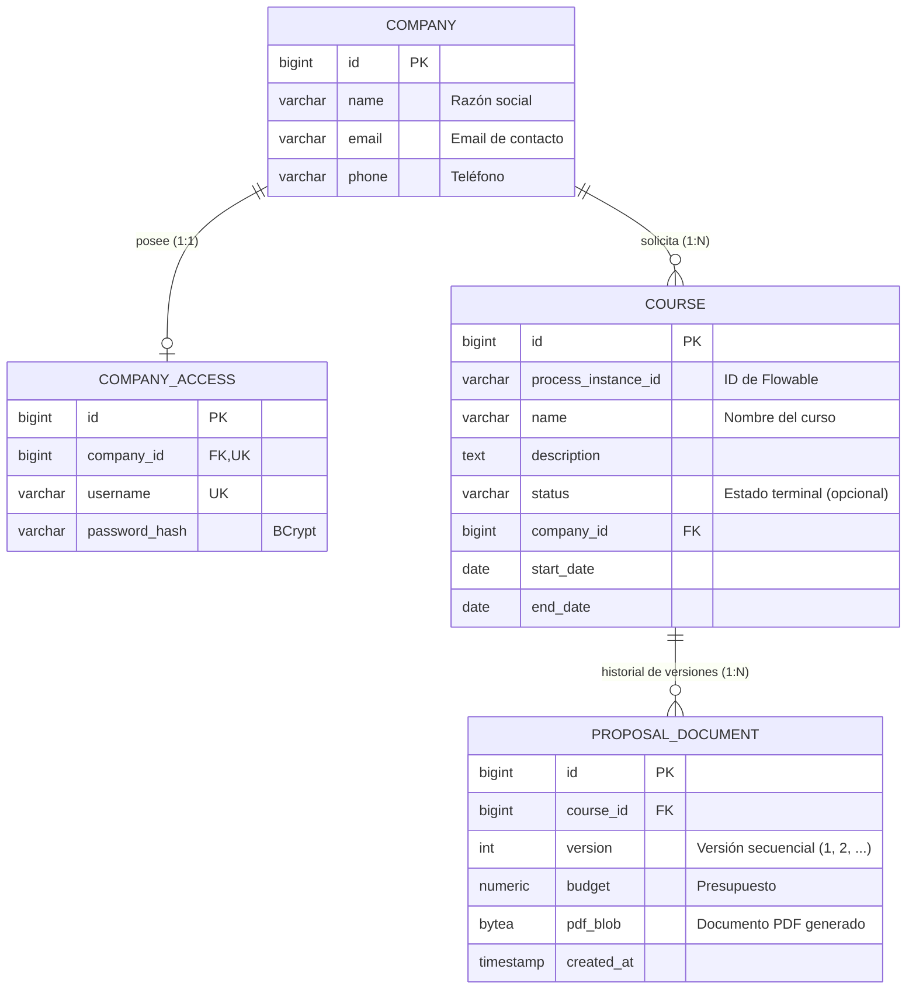

# Entidades y Persistencia

El modelo de datos relacional del backend se persiste en **PostgreSQL** mediante Spring Data JPA. Gestiona los registros transaccionales y de negocio permanentes, garantizando trazabilidad histórica e independencia del ciclo de vida de los procesos en Flowable.

---

## Diagrama Entidad-Relación

---

## Descripción de Entidades

### 1. `Course`
Representa el expediente central de una capacitación.
- **`processInstanceId`**: Identificador unívoco de la instancia de proceso en Flowable que orquesta su ciclo de vida.
- **`status` (`CourseStatus`)**: Almacena el resultado final cuando el curso concluye o se cierra tempranamente (`NO_VIABLE`, `RECHAZADO`, `SIN_RESPUESTA`, `FINALIZADO`, `CANCELADO`).
- **`possibleDates`**: Lista de fechas sugeridas inicialmente por la empresa (almacenadas como JSON en la base de datos).

### 2. `Company` y `CompanyAccess`
- **`Company`**: Datos de contacto y razón social de la empresa cliente.
- **`CompanyAccess`**: Credenciales de acceso al portal de clientes generadas automáticamente durante la etapa de evaluación (§4.1.2). La contraseña se almacena con hash irreversible vía `BCryptPasswordEncoder`.

### 3. `ProposalDocument`
Historial de versiones de la propuesta comercial y pedagógica enviada a la empresa (§4.1.3).
- **Versionado automático:** Cada revisión o contrapropuesta genera un nuevo registro con número de versión incremental (`version`).
- **Archivo binario (`pdf_blob`):** Contiene el PDF compilado por `ProposalPdfBuilder`, permitiendo a la empresa y a la institución descargar cualquier versión histórica.

---

## Estados y Etapas (`CourseStage` y `CourseStatus`)

La interfaz y los DTOs calculan la etapa visual (`CourseStage`) dinámicamente:
- **Etapas activas (en curso):** `EN_EVALUACION`, `PROPUESTA_ENVIADA`, `EN_PREPARACION`, `CONFIRMADO_PENDIENTE_INICIO`, `EN_DESARROLLO`, `EN_ELABORACION_INFORME`.
- **Etapas cerradas/terminales:** Mapeadas desde `CourseStatus` (`FINALIZADO`, `CANCELADO`, `RECHAZADO`, `NO_VIABLE`, `SIN_RESPUESTA`).

---

## Próximo Paso

- Aprende a configurar el entorno de ejecución en [Setup y Ejecución](../guias/setup.md).
